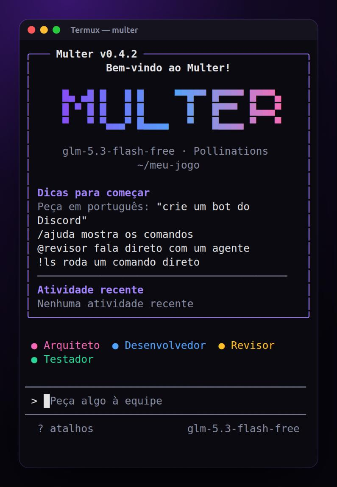
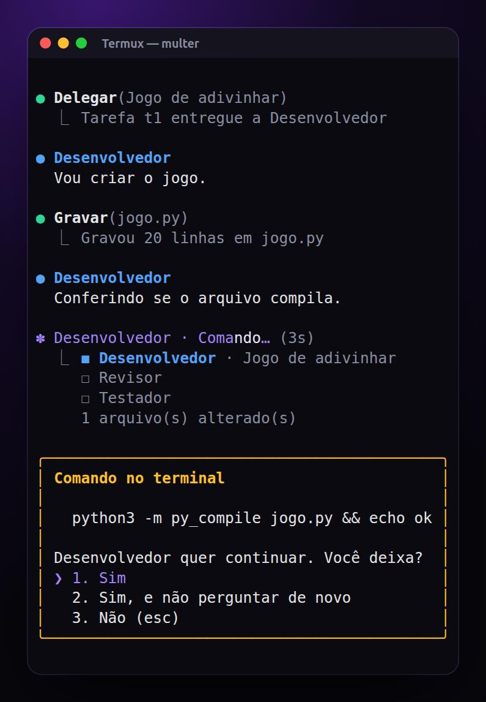
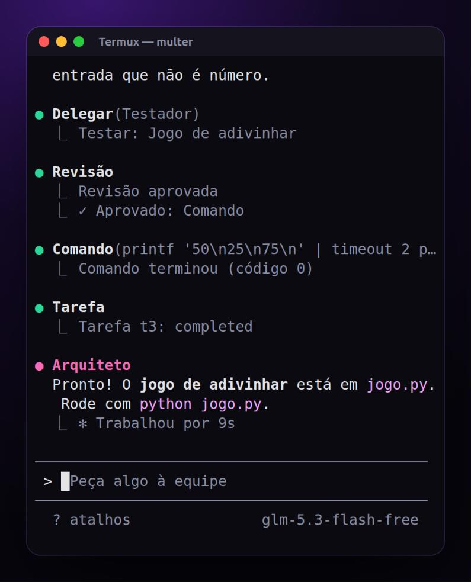

<div align="center">



# Multer para Android

**Uma equipe de agentes de IA no terminal do seu celular.**<br>
Você pede em português e o arquiteto, o desenvolvedor, o revisor e o testador criam o projeto em arquivos de verdade, dentro do Termux.

[](https://github.com/lexersonly/multer-android/blob/main/package.json)
[](https://termux.dev)
[](https://nodejs.org)
[](https://discord.gg/tjbU6Vknm)
[](LICENSE)

[Instalar](#-instalação) · [Como usar](#-como-usar) · [Comandos](#-comandos-e-atalhos) · [Bot do Discord](#-bot-do-discord) · [Problemas comuns](#-problemas-comuns) · [Reportar bug](#-bugs-e-sugestões)

</div>

---

## ✨ Por que usar

<table>
<tr>
<td width="50%" valign="top">

</td>
<td width="50%" valign="top">

</td>
</tr>
<tr>
<td align="center"><sub>A equipe trabalhando, com a lista de tarefas e o pedido de permissão</sub></td>
<td align="center"><sub>Pedido pronto: revisão aprovada, teste feito e resumo</sub></td>
</tr>
</table>

- 🧠 **Equipe de quatro agentes.** O arquiteto entrega o pedido, o desenvolvedor faz, e o revisor e o testador vêm sozinhos em seguida.
- 🛠️ **Arquivos e comandos reais.** Os agentes leem, escrevem e editam arquivos e rodam comandos na pasta do projeto.
- ✅ **Código conferido.** Cada arquivo gravado tem a sintaxe conferida na hora (Python, JavaScript, JSON e shell), e a tarefa só fecha com o trabalho feito.
- 🔒 **Você decide.** Comandos arriscados pedem permissão antes de rodar, e os tokens ficam guardados sem que os agentes vejam o valor.
- 🤖 **Bots e servidores.** Os agentes criam e rodam um bot do Discord em segundo plano.
- 📱 **Feito para o celular.** Interface no jeito do Claude Code, conversa salva por pasta, Termux acordado durante o trabalho e aviso quando a equipe termina.
- 🆓 **Modelos gratuitos.** Usa a sua conta do Pollinations, com troca de modelo em um comando.

## 🚀 Instalação

Você precisa do [Termux](https://f-droid.org/packages/com.termux/) (prefira o do F-Droid, o da Play Store é antigo) e de uma conta no Pollinations.

No Termux, cole esta linha. Ela não usa git nem pede login no GitHub:

```bash
curl -fsSL https://raw.githubusercontent.com/lexersonly/multer-android/main/bootstrap.sh | bash
```

Ela baixa o projeto em `~/multer-android` e instala o Node, o Bun e o comando `multer`. Quer ler antes de rodar? O script é o [`bootstrap.sh`](bootstrap.sh).

Confira se deu tudo certo:

```bash
multer --doutor
```

<details>
<summary><b>Instalar com git, atualizar e desinstalar</b></summary>

#### Com git

O repositório é público, então o clone não pede conta. Se pedir username, o endereço está errado.

```bash
pkg update -y && pkg install -y git
```

```bash
GIT_TERMINAL_PROMPT=0 git clone https://github.com/lexersonly/multer-android.git ~/multer-android
```

```bash
bash ~/multer-android/install.sh
```

#### Atualizar

Dentro do `multer`, digite `/atualizar`. Ele baixa a versão nova e mantém o login e as configurações, que ficam em `~/.config/multer-android`. Depois, feche e abra o `multer`. Fora da interface, use `multer --atualizar`.

Não guarde arquivos seus dentro de `~/multer-android`: a atualização troca a pasta inteira.

#### Desinstalar

```bash
rm -rf ~/multer-android ~/.config/multer-android "$PREFIX/bin/multer"
```

</details>

## 🔑 Login

1. Baixe o **[APK Multer Token](https://multer-phi.vercel.app/downloads/multer-token.apk)** (cerca de 8 MB), entre com o Discord e faça o login no Pollinations.
2. Toque em **Copiar** no token que o APK mostra.
3. No Termux, abra o `multer`, digite `/login`, cole o token e aperte Enter.

O token fica só no aparelho, em `~/.config/multer-android/credential`, e não aparece na tela. Trate-o como uma senha.

<details>
<summary><b>Outras formas de entrar</b></summary>

- **Sem o APK:** `/login chave` abre o login oficial do Pollinations para terminais no navegador. Você aprova e o Multer recebe uma chave `sk_`, válida por 7 dias.
- **Variável de ambiente:** `POLLINATIONS_API_KEY` também é aceita e tem prioridade sobre a credencial salva.
- O token do APK tem o formato `token=<seu-token>; oauth_session_id=<sua-sessão>`, e o `oauth_session_id` é obrigatório.

</details>

### 🆓 Sem login: modelos gratuitos

O Multer já vem com uma lista de modelos gratuitos que não pedem conta. Eles aparecem no
`/modelos` com o dono **grátis** e funcionam só de abrir:

```bash
multer -p "escreva um script que renomeia fotos por data"
```

O pool de chaves vem do site do Multer em tempo de execução e fica em cache por 10 minutos em
`~/.config/multer-android/free-keys.json` — **nada de chave é escrito no repositório**. A rota
exige um token só de leitura, separado do que escreve chaves. Cada
chave serve 3 pedidos por minuto e por modelo; quando estoura, o pedido passa para a próxima e,
se o modelo inteiro encher, para outro modelo grátis. As gratuitas são limitadas: para uso
longo, faça `/login`.

<details>
<summary><b>Apontar para outro pool</b></summary>

- `MULTER_FREE_TOKEN` troca o token de leitura, se o embutido for trocado no servidor.
- `MULTER_FREE_URL` troca o endereço de onde as chaves são lidas.
- `MULTER_FREE_KEYS=sk-aaa,sk-bbb` usa chaves suas e ignora o pool do site.
- `MULTER_FREE_API_URL` troca a API do provedor.

</details>

## 💬 Como usar

Entre na pasta do projeto e abra o Multer:

```bash
mkdir -p ~/meu-jogo && cd ~/meu-jogo
```

```bash
multer
```

Escreva o pedido e aperte Enter, por exemplo:

> crie um jogo da cobrinha em Python com placar e recorde salvo

O pedido vai para o arquiteto, e a lista de tarefas mostra quem está trabalhando: ☒ feito, ◼ agora, ☐ falta. Quando um comando precisar da sua permissão, escolha com as setas e Enter, ou com `1`, `2` e `3`.

- **Falar com um agente:** comece com o nome dele, como `@revisor olhe o jogo.py`.
- **Rodar um comando direto:** comece com `!`, como `!python jogo.py`.
- **Deixar a equipe trabalhar sem parar:** aperte `Shift+Tab` ou digite `/auto`. Tudo é aprovado sozinho até você desligar.
- **Voltar depois:** a conversa fica salva por pasta. Se o Android fechar o Termux, `/retomar` traz de volta, e `continua` devolve a tarefa aberta a quem cuidava dela.
- **Sem interface:** `multer -p "pedido"` roda um pedido só e recusa tudo o que precisaria de aprovação.

## 🧰 Comandos e atalhos

Digite `/` para ver a lista: navegue com as setas, `Tab` completa e Enter roda. Todo comando tem nome em português e em inglês.

| Comando | O que faz |
| --- | --- |
| `/login` · `/login chave` | Entrar com o token do APK ou pelo navegador |
| `/modelos` · `/modelo N` | Listar os modelos gratuitos e trocar por número ou nome |
| `/retomar` · `/cancelar` | Voltar à conversa salva · interromper a equipe |
| `/arquivos` · `/tarefas` · `/equipe` | Ver o que mudou, as tarefas e os agentes |
| `/auto` | Ligar e desligar a aprovação automática |
| `/segredo NOME` | Guardar um segredo, como `DISCORD_TOKEN` |
| `/processos` · `/logs NOME` · `/parar NOME` | Ver, ler e parar bots e servidores |
| `/rea ligar` · `/rea desligar` | Ligar ou desligar o plugin REA |
| `/limpar` · `/atualizar` · `/ajuda` · `/sair` | Nova conversa · atualizar · ajuda · fechar |

| Atalho | O que faz |
| --- | --- |
| `?` | Mostra os atalhos |
| `!comando` | Roda direto no terminal |
| `@agente texto` | Fala com um agente |
| `Shift+Tab` | Aprova tudo sozinho |
| `↑` `↓` | Pedidos anteriores |
| `Esc` | Interrompe a equipe · duas vezes apaga o texto |
| `Ctrl+U` · `Ctrl+W` | Apaga o texto · apaga a palavra |
| `Ctrl+C` | Interrompe ou limpa · duas vezes seguidas fecha |

> **No celular:** `Esc`, `Ctrl` e as setas ficam na linha de teclas extras do Termux. Se ela não aparecer, aperte **Volume + e Q**. Para colar, toque e segure na tela e escolha **Paste**.

## 🤖 Bot do Discord

Peça, por exemplo: `crie um bot de Discord que responde /ping e rode ele`.

1. **Crie o bot** no [Portal de Desenvolvedores do Discord](https://discord.com/developers/applications), copie o token e convide o bot para o seu servidor.
2. **Entregue o token** quando o agente pedir, ou antes, com `/segredo DISCORD_TOKEN`. Ele não aparece na tela e fica só no aparelho.
3. **Aprove** quando o agente pedir para rodar o bot.

Os agentes só sabem o **nome** do segredo: o valor vai direto para o bot e vira `***` em qualquer log. Veja o que está rodando com `/processos` e pare com `/parar NOME`. Os bots param quando você fecha o `multer`.

<details>
<summary><b>O que pede permissão</b></summary>

| Situação | O que acontece |
| --- | --- |
| Comando que só lê dentro do projeto | Roda direto |
| Outros comandos | Pergunta: sim, sim sem perguntar de novo, ou não |
| Comandos destrutivos, credenciais, `git push`, `adb`, `pkg install` e parecidos | Pergunta toda vez |
| Rodar algo em segundo plano, como um bot | Pergunta, mostrando o comando e os segredos usados |

As ferramentas de arquivo não saem da pasta do projeto nem abrem `.env` e arquivos parecidos. Os comandos dos agentes não recebem a sua credencial.

</details>

## 🧩 REA

O [`rea-agents`](https://www.npmjs.com/package/rea-agents) 6.8.0 é o plugin de análise de bytes, formatos binários e aplicações. Ele vem instalado e fica desligado até você usar `/rea ligar` ou aprovar o pedido de um agente. As 229 ferramentas ficam fora do prompt: os agentes as procuram com `find_tools`.

Ele exige Node `^22.23.4 || ^24.22.1 || >=26.12.1`, e o `nodejs-lts` e o `nodejs` do Termux atendem. Use o REA só para análise lícita.

## 📱 Dicas no celular

- **Tarefas longas:** o Multer mantém o Termux acordado enquanto a equipe trabalha. Com `pkg install termux-api` e o app Termux:API, o celular avisa quando ela termina ou pede permissão.
- **Arquivos do aparelho:** rode `termux-setup-storage` uma vez e eles aparecem em `~/storage/shared`. O Multer trabalha melhor em pastas do Termux, como `~/meu-jogo`.
- **Espaço:** reserve cerca de 200 MB para o projeto, além do Node e do Bun, que somam cerca de 130 MB.
- **Modelos:** se um modelo se perder, troque com `/modelos` e `/modelo N`.

## 🩺 Problemas comuns

Comece sempre por `multer --doutor`: ele mostra o Node, o login e o REA, sem revelar a credencial.

<details>
<summary><b>Instalação</b></summary>

| O que aparece | Causa provável | Solução |
| --- | --- | --- |
| `Username for 'https://github.com'` | Endereço digitado errado | Aperte `Ctrl+C`, não digite senha e use a linha com `curl` |
| `curl: (6) Could not resolve host` | Sem internet ou DNS falhando | Confira a conexão e tente de novo |
| `curl: (22)` ou `O download veio incompleto` | Falha no download | Rode a linha de novo |
| `Unable to locate package` | Lista de pacotes velha ou espelho fora do ar | Rode `pkg update`; se continuar, `termux-change-repo` |
| `pkg` falhando sempre | Termux antigo, da Play Store | Instale o do [F-Droid](https://f-droid.org/packages/com.termux/) |
| `Este instalador é para o Termux` | Rodou fora do Termux | Rode dentro do app Termux |
| `Não consegui instalar o Bun` | Espelho fora do ar ou falta de espaço | Rode `termux-change-repo` e `df -h ~` e instale de novo |
| `multer: command not found` | A instalação não terminou | Feche e abra o Termux; se continuar, instale de novo |
| `ERR_UNKNOWN_FILE_EXTENSION` | Node anterior ao 22.18 | Rode `pkg install nodejs-lts` |

</details>

<details>
<summary><b>Login</b></summary>

| O que aparece | Causa provável | Solução |
| --- | --- | --- |
| `O token veio sem o oauth_session_id` | Só parte do texto foi colada | Toque em **Copiar** de novo no APK e cole tudo |
| `O Pollinations recusou este token` | Token vencido ou de outra sessão | Faça login de novo no APK |
| `Token salvo, mas sem conferir` | Sem conexão com o Pollinations | Pode usar: se for inválido, o erro aparece no primeiro pedido |
| `A sessão expirou ou é inválida: rode /login` | O login venceu | Rode `/login` com um token novo |
| O navegador não abre no `/login chave` | `termux-open-url` indisponível | Abra o endereço da tela no navegador |

</details>

<details>
<summary><b>Modelos e agentes</b></summary>

| O que aparece | Causa provável | Solução |
| --- | --- | --- |
| `Model not found` | O modelo não existe na sua conta | O Multer troca sozinho; se continuar, mande a mensagem no Discord |
| `demorou mais de 60s` | Modelo de raciocínio lento no arquiteto | O pedido segue para o desenvolvedor; troque com `/modelos` |
| `Nenhum modelo gratuito respondeu agora` | Modelos comunitários fora do ar | Tente mais tarde |
| `disse que ia agir, mas o modelo não chamou a ferramenta` | Modelo pequeno demais | Troque com `/modelos` e `/modelo N` |
| `Tarefa ainda não concluída` | O desenvolvedor tentou fechar sem terminar | Normal: ele recebe o motivo e continua |
| `foi cortado N vezes no limite` | Arquivo grande demais para o modelo | Peça em partes menores ou troque de modelo |

</details>

<details>
<summary><b>REA</b></summary>

| O que aparece | Causa provável | Solução |
| --- | --- | --- |
| `O REA 6.8.0 exige Node` | Node sem a versão exigida | Rode `pkg install nodejs-lts` |
| `O REA não iniciou` | Falha ao abrir o plugin | Rode `multer --doutor-rea` para ver o erro |
| Uma ferramenta do REA falha | Depende de `node-pty` ou `frida`, sem binário para Android | Peça ao agente outra ferramenta com `find_tools` |

</details>

## 📝 Novidades

O Multer recebe atualizações toda semana. Para receber, digite `/atualizar`.

**0.4.2**
- Cada arquivo que o desenvolvedor grava tem a sintaxe conferida na hora, e o erro volta para ele corrigir.
- O "pronto" do desenvolvedor só vale com trabalho feito: sem arquivo alterado, com erro de sintaxe ou com o último comando falhando, a tarefa não fecha.
- Pedido com várias partes: antes de fechar, ele confere a lista do que foi pedido.

**0.4.1**
- Interface nova no jeito do Claude Code, nas cores do Multer: logo animado, boas-vindas com dicas, lista de tarefas e "Trabalhou por" no fim.
- Permissão com opções numeradas, menu de `/` com as setas, `!comando`, `?` para os atalhos e `Shift+Tab` ou `/auto` para aprovar tudo.
- `Ctrl+C` interrompe ou limpa e só fecha na segunda vez seguida.
- O arquiteto não diz mais "pronto" antes de a equipe trabalhar.

<details>
<summary><b>Versões anteriores</b></summary>

**0.4.0**
- Os agentes guardam o que já leram e param de reler os mesmos arquivos.
- Desenvolvedor que só fala não conclui a tarefa: ela volta uma vez e, se não andar, aparece como não concluída.
- `continua` devolve a tarefa aberta para quem cuida dela, e `/retomar` traz a conversa salva por pasta.
- O Termux fica acordado enquanto a equipe trabalha, e o celular avisa quando ela termina.
- Modelo preso repetindo a mesma frase é cortado, em vez de gastar a cota.

**0.3.0**
- A equipe trabalha sozinha em sequência: arquiteto, desenvolvedor, revisor e testador.
- Atualização com `/atualizar`, troca de modelo por número e comandos em português e inglês.
- Bots e servidores em segundo plano, com segredos que os agentes nunca veem.

**0.2.0**
- Login com o token copiado do APK Multer Token.

</details>

## ⚠️ Limitações

- **Pode bugar:** cada celular e cada versão do Android é diferente, e os modelos gratuitos mudam de comportamento.
- **Modelos gratuitos:** são comunitários e podem sair do ar. Use `/modelos` para ver quais respondem.
- **Login:** o token e a chave `sk_` vencem; quando isso acontecer, entre de novo.
- **Sem busca na web:** os agentes não pesquisam na internet.
- **REA no Android:** ferramentas que dependem de PTY ou de instrumentação de processo podem falhar.

## 🐛 Bugs e sugestões

O Multer está em evolução, e o melhor jeito de ajudar é contar o que aconteceu:

- 💬 **Discord:** [entre no servidor](https://discord.gg/tjbU6Vknm) para reportar bugs, dar sugestões e ver as novidades.
- 📮 **Issue:** [abra uma issue](https://github.com/lexersonly/multer-android/issues/new), para erro ou ideia.
- Inclua o que você pediu, o que aconteceu, o texto do erro e a saída de `multer --doutor` e `multer --versao`.
- **Nunca publique o seu token.**

## 👩‍💻 Desenvolvimento

O código é TypeScript e o Node remove os tipos ao carregar, então não há build no celular. A interface usa [Ink](https://github.com/vadimdemedes/ink).

```bash
bun install
```

```bash
bun run check
```

```text
bin/multer.js   entrada
src/cli.ts      argumentos e modos
src/agents/     parser, equipe, prompt, laço dos agentes e conferência do trabalho
src/auth/       credencial, token colado e login pelo navegador
src/provider/   chat com streaming
src/tools/      arquivos, busca, comandos e aprovação
src/plugins/    cliente MCP e REA
src/ui/         interface, logo e comandos
test/           testes
docs/           imagens deste README
```

## 📄 Licença

[MIT](LICENSE).
